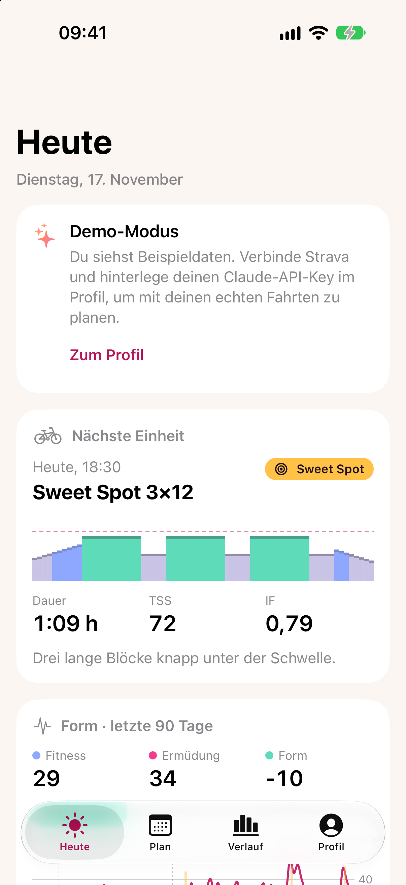
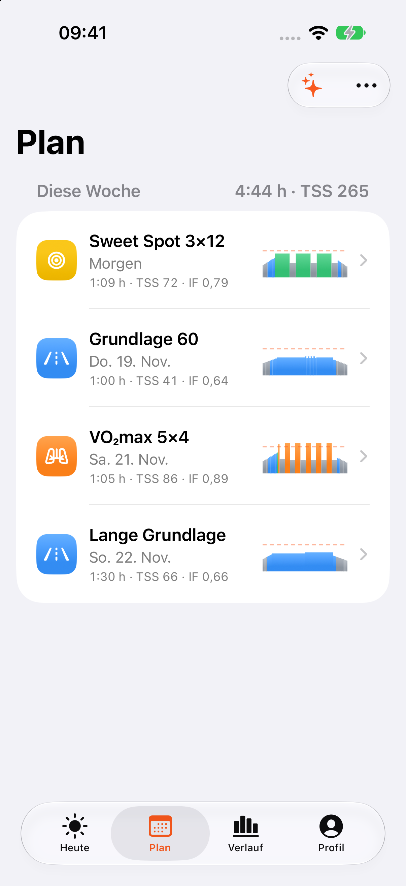
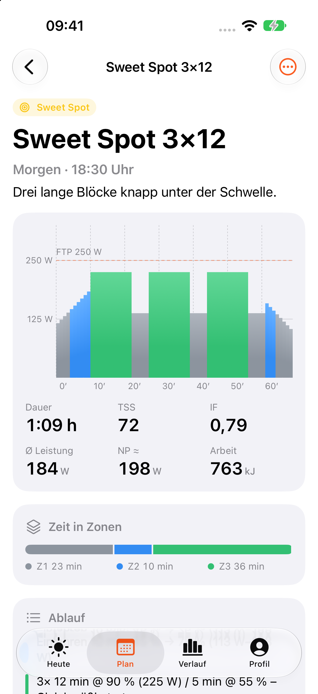
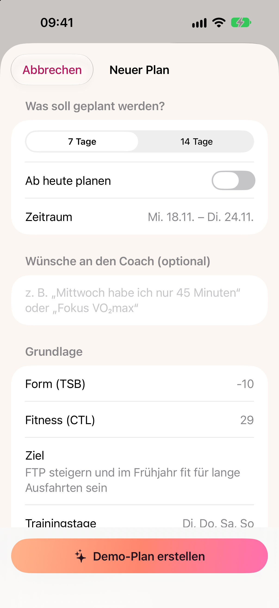
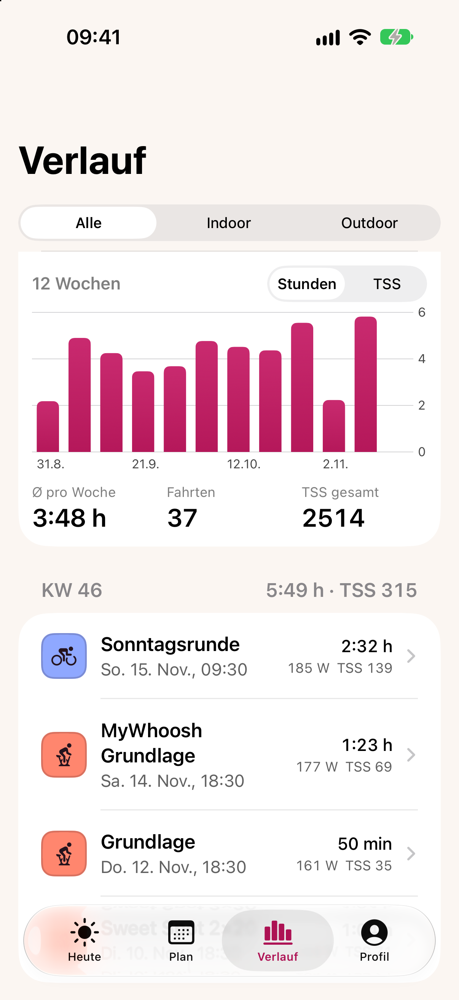
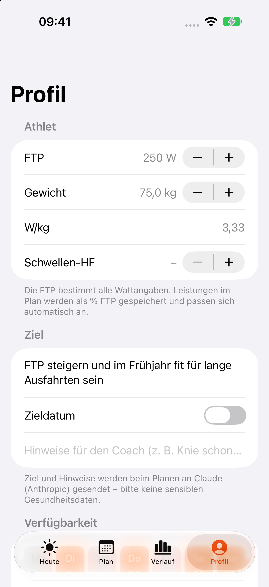

# IndoorCoach

Persönliche iOS-App für Indoor-Rennrad-Training im Winter:
- **Daten:** Fahrten aus Strava, MyWhoosh oder FIT-Dateien laden.
- **Planen:** mit Claude planen, in den Kalender eintragen und direkt an MyWhoosh senden (`.zwo` als Rückfallweg).
- **Fortschritt:** Leistungskurve, VO2max, Fitness & Freshness, Relative Effort, aerobe Effizienz.
- **Motivation:** Winter Arc mit Leveln, Konstanz-Serie mit Joker, Wochenrückblick, Saison-Challenges und Trophäen.

Läuft vollständig auf dem iPhone, ohne Backend.

| Heute | Plan | Einheit | Planer | Verlauf | Profil |
|-------|------|---------|--------|---------|--------|
|  |  |  |  |  |  |

*(iOS-27-Simulator, iPhone 18 Pro, Demo-Daten, Farbsystem „Sunset Jelly“. Dunkelmodus: `snapshots/sim/07-heute-dark.png`, `08-workout-dark.png`)*

## Dokumente

1. [PRD](docs/01-PRD.md) – Ziele, User Stories, Annahmen
2. [Konzept & Architektur](docs/02-KONZEPT.md) – Entscheidungen, Datenmodell, Prompt-Design, MyWhoosh-Optionen, Risiken, Slices
3. [Installation & Einrichtung](docs/03-INSTALLATION.md) – Xcode, Strava-API-App, Claude-Key, MyWhoosh-Import
4. [Status & nächste Schritte](docs/04-STATUS.md)
5. [UX-Audit 17.11.2026](docs/ux-audit-2026-11-17.md) – ux-audit-Skill, 15 Befunde behoben, Farbsystem
6. [Winter Arc: Relative Effort, Fitness & Freshness, Level](docs/05-FEATURES-WINTER-ARC.md)
7. [Backlog bis zur Pilotphase](docs/06-BACKLOG-PILOT.md)
8. [Pilot-Testplan](docs/07-PILOT-TESTPLAN.md) – Gerätematrix, Szenarien, Live-Checks, 4-Wochen-Ablauf, Feedback-Fragen
9. [Leistung: Leistungskurve, Bestleistungen, VO2max](docs/08-FEATURES-LEISTUNG.md)
10. [Brainstorming & Marktanalyse: Winter-Motivation](docs/09-BRAINSTORM-WINTER-MOTIVATION.md)
11. [Konstanz-Paket: Serie mit Joker, Wochenrückblick, Challenges, Effizienz](docs/10-KONSTANZ-PAKET.md)
12. [UX-Audit 2 der erweiterten Version](docs/ux-audit-2026-11-17-b.md) – 6 Befunde behoben, offen: Kontrast-Knoten fürs Gerät

## Secrets

Claude-API-Key, Strava-Client-Secret/-Tokens und die MyWhoosh-Sitzung werden in der App eingegeben und
ausschließlich im iOS-Schlüsselbund (Keychain) gespeichert – nie im Code oder in Konfigurationsdateien.
Keys, Signing-Zertifikate oder Provisioning-Profile niemals committen; lokale Overrides gehören in
`Config/Local.xcconfig` (per `.gitignore` ausgeschlossen). Die eigene `DEVELOPMENT_TEAM`-ID bitte nur lokal setzen.

## Aufbau

```
App/                    App-Hülle (@main, Assets)
Config/Info.plist       URL-Schema für Strava-OAuth, .zwo-Typ
IndoorCoachKit/         Swift Package mit der gesamten Logik und UI
  Sources/IndoorCoachKit/
    Domain/             Workout, Zonen, TSS/CTL/ATL, .zwo-Export, Profil, Winter Arc, Leistungskurve,
                        VO2max, Konstanz, Wochenrückblick, Challenges, Trophäen, Effizienz
    Services/           StravaClient, ClaudeClient + PlanPrompt, MyWhooshClient, FIT-Parser, Kalender,
                        Keychain, Log/Diagnose, Erinnerungen, Demo
    Store/              SwiftData-Modelle, AppModel
    UI/                 SwiftUI-Screens
  Tests/                Unit-Tests (swift test)
IndoorCoachUITests/     UI-Walkthrough-Tests (Simulator)
  Sources/SnapshotTool/ rendert Screens als PNG (macOS)
docs/                   Planung & Konzept
```
