<p align="center">
  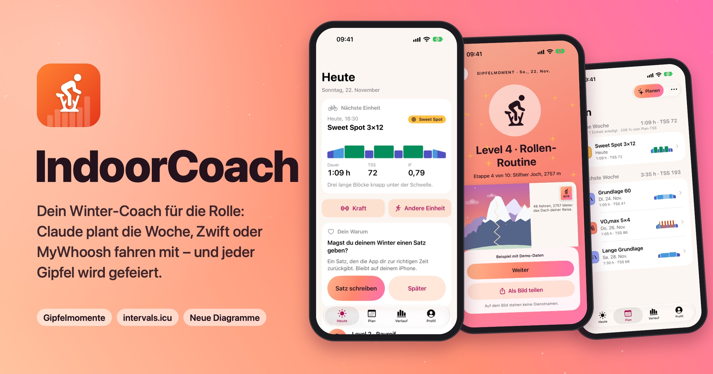
</p>

<p align="center">
  
  
  
  
  
  
  <a href="https://github.com/jpfrehe/IndoorCoach/actions/workflows/ci.yml"></a>
</p>

# IndoorCoach

**Der persönliche Winter-Coach für Rennradfahrer auf der Rolle.**
IndoorCoach plant deine Indoor-Woche mit Claude, schickt die Einheiten direkt an MyWhoosh – oder über intervals.icu an Zwift, Garmin, Wahoo und Rouvy – und in deinen Kalender. Es zeigt dir ehrlich, ob du auf Kurs bist, um im Frühling in Form zu sein, und feiert jeden Gipfel auf dem Weg dorthin.

Im Winter sinkt das Radvolumen bei vielen um ein Drittel. IndoorCoach setzt genau da an:
- **Konstanz statt Tagesstreaks:** Wochen-Serie mit Joker, Ruhewochen zählen als Erfolg. Wenig Zeit heute? Die Einheit mit zwei Tipps auf 45 min kürzen statt ausfallen lassen.
- **Fortschritt sichtbar machen:** Leistungskurve, VO₂max, Fähigkeitslevel und Fitness-Prognose zeigen, dass die Arbeit ankommt. Nach jeder Fahrt siehst du, ob du deine Intervalle getroffen hast.
- **Ein Grund für die nächste Einheit:** Winter Arc mit 10 Leveln, Alpenüberquerung als Etappenreise mit Postkarten, Challenges und Trophäen – und ein Gipfelmoment, wenn du etwas geschafft hast.
- **Jede MyWhoosh-Fahrt sekundengenau, ohne Handgriff:** Die kleine Mac-App „IndoorCoach Brücke“ holt die Daten aus MyWhoosh und bringt sie im WLAN aufs iPhone.
- **Neu – die ganze Woche im Blick:** Brustgurt direkt am iPhone, Krafttraining im Studio, Check-in vor der Einheit, Aufwärm-Check und auf Wunsch Apple Health. Der Plan kennt jetzt auch deine schweren Beine vom Dienstag.

Alles läuft auf deinen Geräten: auf dem iPhone und auf Wunsch zusätzlich auf dem Mac. Es gibt kein Backend und kein Konto bei IndoorCoach; Schlüssel und Sitzungen liegen im Schlüsselbund. Die Brücke überträgt Fahrten nur im eigenen WLAN. An Claude gehen nur zusammengefasste Trainingsdaten, wenn du planst – Erholungswerte nur mit deiner ausdrücklichen Einwilligung und nur relativ zu deiner eigenen Basis.

**In wenigen Minuten startklar, auch ohne Technikwissen:** Die Einführung fragt Training und Trainingstage ab und dann in Alltagssprache, womit du drinnen fährst (MyWhoosh, Zwift, Rouvy, noch keine App) und was du sonst nutzt (Apple Watch, Garmin, Brustgurt, Strava). Daraus empfiehlt sie die passenden Dienste – etwa intervals.icu für Zwift – und verbindet sie direkt. Kein Dienst ist Pflicht, der Claude-Coach ist optional. Danach zeigt eine kurze animierte Tour, was die App kann. Ohne Verbindung startet die App mit Demo-Daten ([Konzept](docs/20-KONZEPT-ONBOARDING-DIENSTE.md)).

---

## Neu: Vom Frost zum Frühling

Die App hat Level, Etappen und Bestleistungen schon immer berechnet – jetzt überreicht sie sie auch. Vier kleine Momente, die das Winterloch leichter machen, alle lokal, ohne Konto und ohne Claude-Key ([Marktanalyse & Konzept](docs/22-MARKTANALYSE-BEGEISTERUNG.md)):

| Gipfelmoment | Postkarte vom Pass | Winterlicht | Willkommen zurück |
|:---:|:---:|:---:|:---:|
| 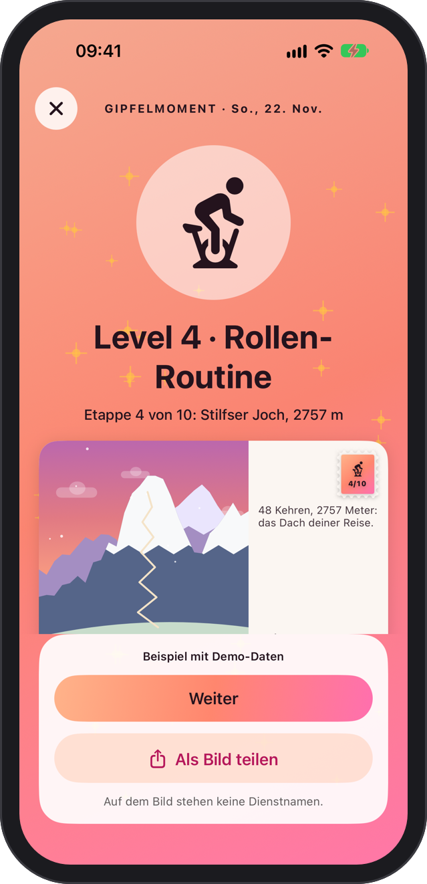 | 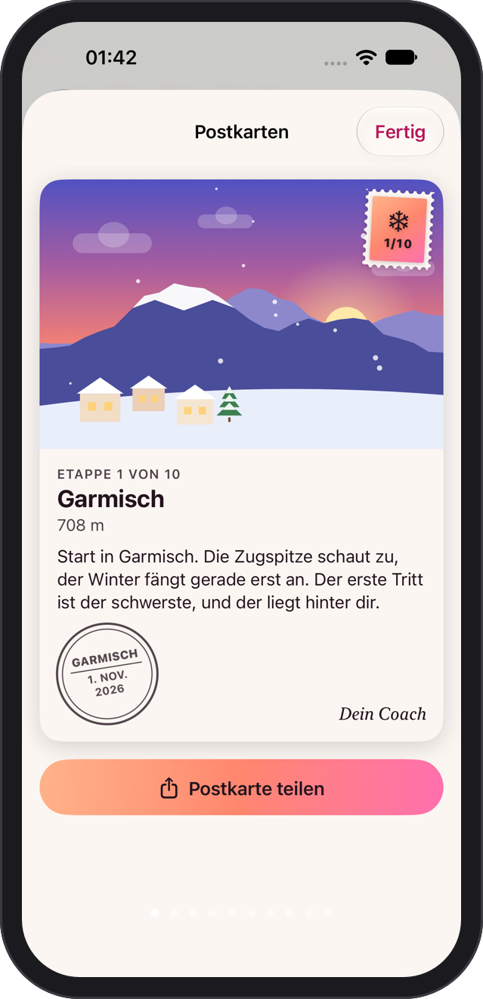 | 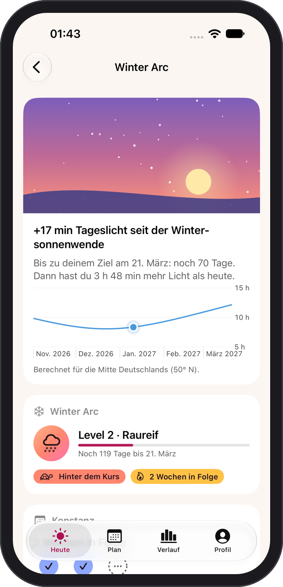 | 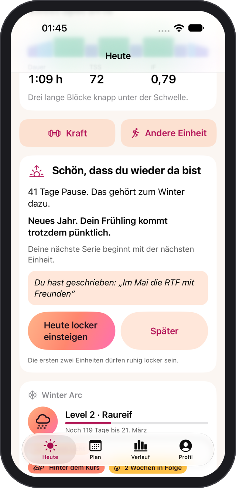 |

- **Gipfelmoment nach der Fahrt:** Neues Level, neue Etappe, Bestleistung, gestiegene FTP-Schätzung, geschaffte Woche oder Comeback – direkt nach dem Import eine ruhige Feier mit „Schnee zu Funken“, einem Coach-Satz mit Quelle und Langzeitbezug und einem teilbaren Bild im Hochformat (Werte und Name nur auf Wunsch). Ohne Zeitlimit, höchstens einmal, nie während der Aufzeichnung; abschaltbar.
- **Postkarten von der Alpenüberquerung:** Zu jeder der 10 Etappen von Garmisch bis an den Gardasee eine selbst gezeichnete Karte mit eigenem Text, Datum und Poststempel – als Album im Winter Arc, „Noch 38 % bis Bormio“.
- **Winterlicht:** „+17 min Tageslicht seit der Wintersonnenwende“ und wie viel Licht bis zu deinem Ziel dazukommt – ohne Ortung, grob aus der Zeitzone. Der Himmel im Winter Arc wird mit deinem Fortschritt heller.
- **Willkommen zurück & Dein Warum:** Nach mindestens zehn Tagen Pause eine freundliche Karte ohne Urteil und „Heute locker einsteigen“ (kürzer, leichter oder Grundlage 30 min). Dein eigener Satz, warum du diesen Winter fährst, kommt im richtigen Moment wörtlich zurück – er bleibt auf dem iPhone und geht nie an Claude.

## Die ganze Woche im Blick

Viele fahren im Winter nicht nur Rolle: dienstags Studio, samstags Laufen, und manchmal ist der Tag einfach zu lang. IndoorCoach sieht jetzt die ganze Woche – lokal, ohne Konto und ohne teures Wearable.

| Kraft & andere Einheit auf Heute | Kraft starten | Krafteinheit im Verlauf | Dein Herz im Winter Arc |
|:---:|:---:|:---:|:---:|
| 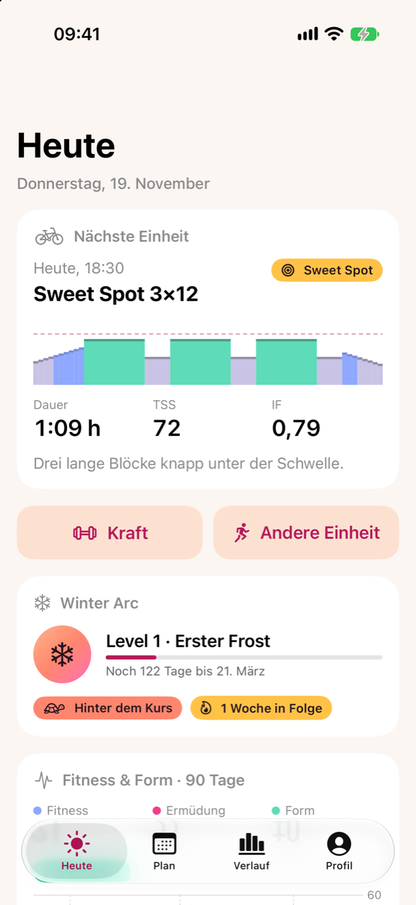 | 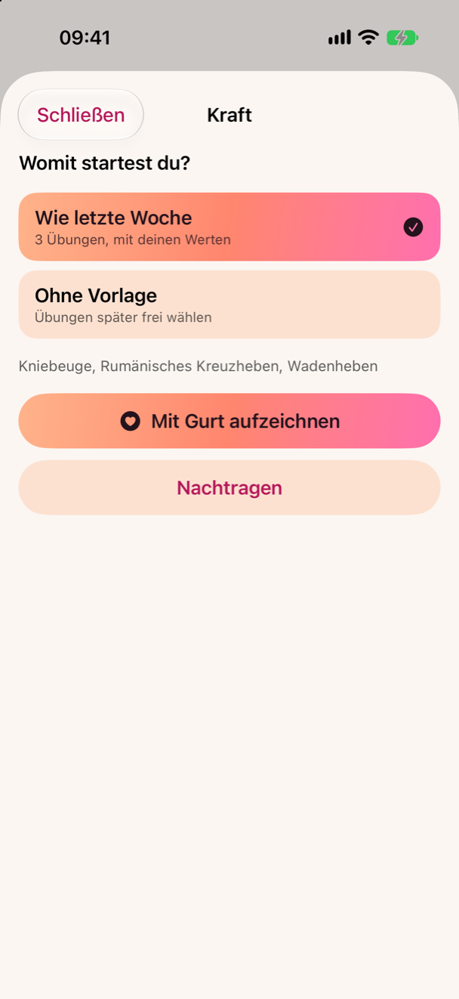 | 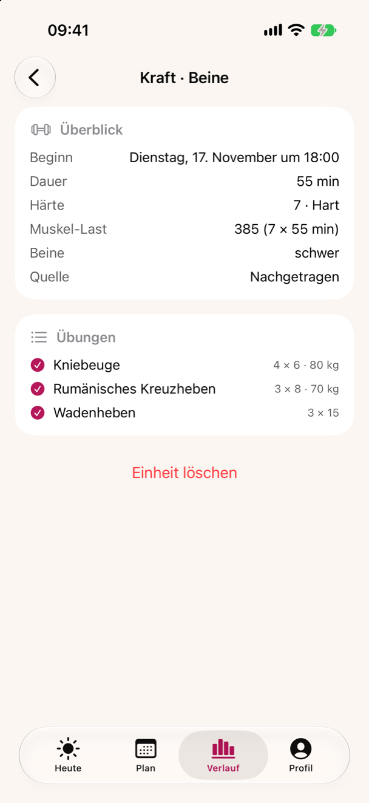 | 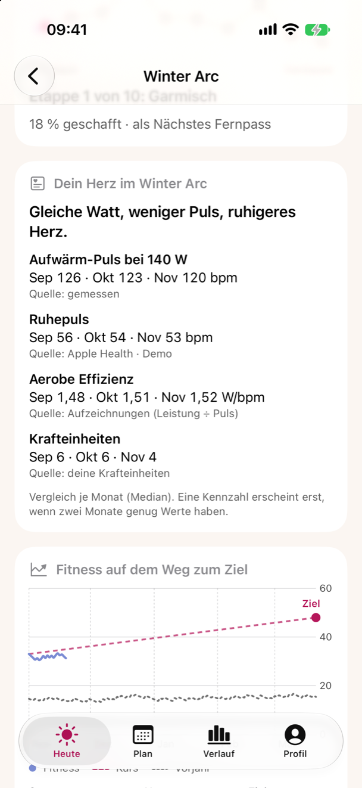 |

- **Brustgurt direkt am iPhone:** Jeder Bluetooth-Pulsgurt (z. B. Wahoo TICKR, Polar H10, Garmin HRM) verbindet sich in *Profil → Dienste & Geräte → Brustgurt*. Puls auf der Rolle auch ohne Mac-Brücke, mit Live Activity auf dem Sperrbildschirm und automatischem Wiederverbinden.
- **Krafttraining im Studio:** Schnellstart „wie letzte Woche“, Übungsliste zum Abhaken (41 Übungen, Vorlagen, Sätze × Wdh × Gewicht), am Ende Härte und „Beine schwer?“ – oder in unter 15 Sekunden nachtragen. Kraft läuft in einer eigenen **Muskel-Spur** und verfälscht nicht deine Rad-Fitness.
- **Andere Einheit:** Laufband, Kurs, Rudergerät – aerobe Einheiten zählen mit geschätzter Puls-TSS zur Wochenlast.
- **Check-in vor der Einheit:** Drei Tipps, alles optional – und bei einem schlechten Tag gibt es Angebote: kürzer, leichter, gegen Grundlage tauschen oder Joker – „angepasst statt ausgefallen“.
- **Aufwärm-Check:** Ein fester 6-min-Block im Aufwärmen misst deinen Puls bei immer gleichen Watt. Sinkt er über die Wochen, wirkt das Training – ganz ohne Uhr.
- **Apple Health (optional):** Fremdsport, Ruhepuls, HRV, Schlaf und Gewicht fließen ein, Dubletten werden erkannt. Auf Wunsch schreibt IndoorCoach eigene Einheiten zurück (ohne Leistungswerte).
- **Erholung im Plan:** Trends gegen deine eigene 28-Tage-Basis, optionale HRV-Morgenmessung mit dem Gurt und ein stiller Trend-Wächter, der nur vor harten Einheiten eine lockerere Alternative anbietet – kein Readiness-Score, keine Pushs, keine Diagnose.
- **Claude kennt die Woche:** Krafteinheiten, Studio-Tage und Fremdsport fließen als weiche Faustregeln in den Plan – etwa keine VO₂max-Einheit innerhalb von 24 Stunden nach schweren Beinen.
- **Dein Herz im Winter Arc:** „Gleiche Watt, weniger Puls, ruhigeres Herz“ – Aufwärm-Puls, Ruhepuls, aerobe Effizienz und Krafteinheiten je Monat, jede Zahl mit Quelle.

Hintergrund, Personas und Entscheidungen: [Brainstorming & Roadmap](docs/17-BRAINSTORM-DATENQUELLEN-ALLTAG.md).

## Planen mit Claude

Claude kennt deine Form (CTL/ATL/TSB), dein Ziel, deine Trainingstage und dein Wochenbudget. Er schlägt strukturierte Einheiten mit Begründung vor; du übernimmst sie mit einem Tipp in Kalender und MyWhoosh. Als Rückfallweg gibt es den Export als `.zwo` für Zwift und andere Apps.

**Einheit anpassen, wenn der Tag anders läuft:** Eine geplante Einheit lässt sich auf 30, 45 oder 60 min kürzen und/oder um 5 bzw. 10 % leichter machen. Die Vorschau zeigt vorher Dauer und TSS. Warm-up und Cool-down bleiben, gekürzt werden zuerst die Füllblöcke. Kalender und MyWhoosh ziehen automatisch nach, „Original wiederherstellen“ macht es rückgängig.

| Wochenplan | Einheit im Detail | Vorschlag des Coachs |
|:---:|:---:|:---:|
| 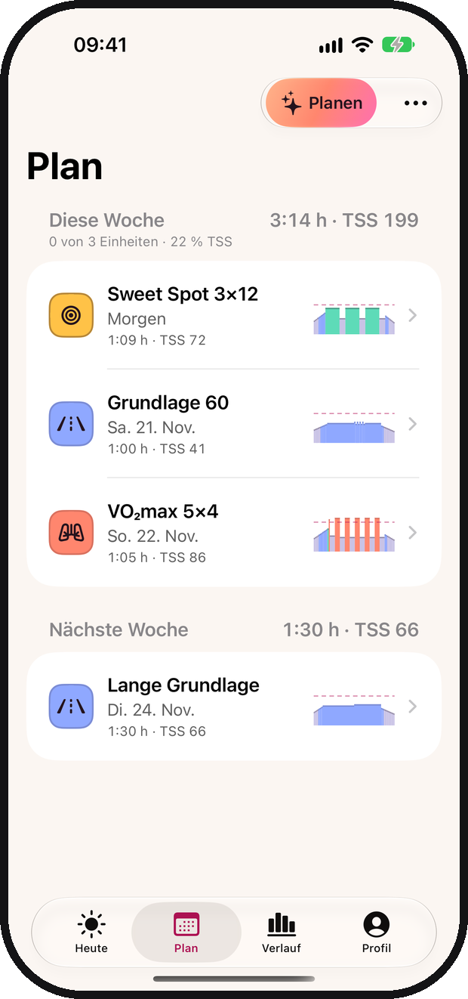 |  |  |

| Einheit anpassen |
|:---:|
| 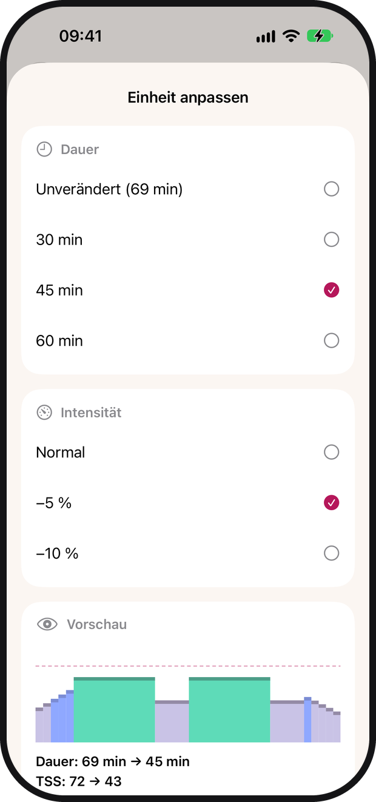 |

## Winter Arc: Motivation, die das Richtige belohnt

Vom 1. November bis zum Frühlingsziel wächst deine Fitness Level für Level – „Erster Frost“ bis „Frühlingsform“. Die Fitness-Kurve zeigt Kurs und Vorjahr, die Winter-Reise führt von Garmisch an den Gardasee.

| Winter Arc & Konstanz | Winter-Reise & Vorjahr | Trophäen |
|:---:|:---:|:---:|
| 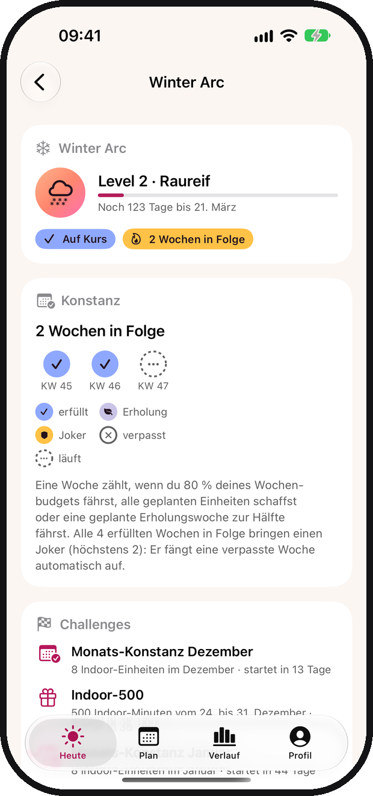 |  |  |

| Prognose mit Was-wäre-wenn | Saisonrückblick zum Teilen |
|:---:|:---:|
|  | 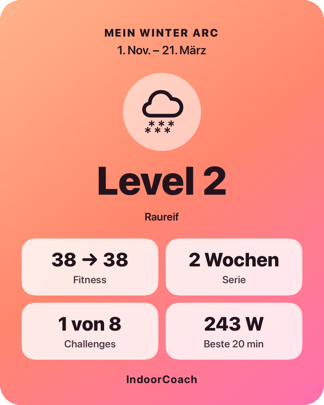 |

**Leitplanken:** keine Tagesstreaks, keine Ranglisten nach Watt, Ruhetage zählen. Jede Kennzahl sagt, woher sie kommt: gemessen, Mindestwert oder geschätzt.

## Analyse wie im Premium-Abo – nur ohne Abo

Alle Diagramme sind neu gezeichnet ([Konzept](docs/21-KONZEPT-DIAGRAMME.md)): eine eigene Zonenpalette mit mindestens 3:1 Kontrast in Hell und Dunkel (auch für Farbfehlsichtige geprüft), Workout-Profile als scharfe, abgerundete Blöcke mit sauberen Rampen und Mindestbreiten für 30/30 und Tabata, glatte Verläufe ohne Überschwinger, der aktuelle Wert hervorgehoben, Auswahl per Tippen und Audio Graphs für VoiceOver.

| Leistungskurve & Bestleistungen | VO₂max & aerobe Effizienz | Fähigkeitslevel (Dark Mode) |
|:---:|:---:|:---:|
| 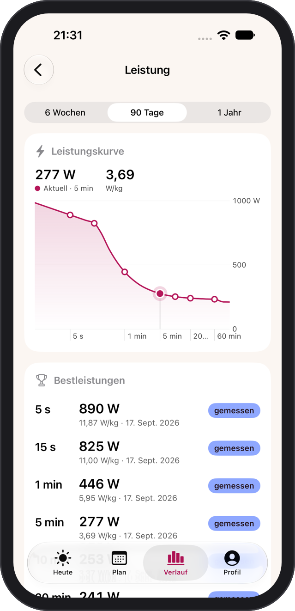 | 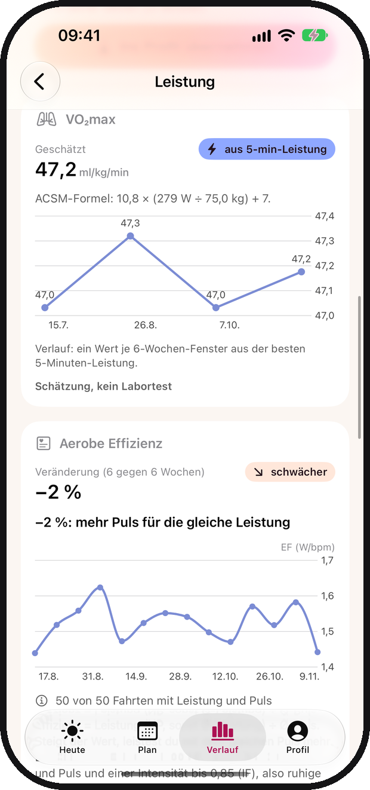 | 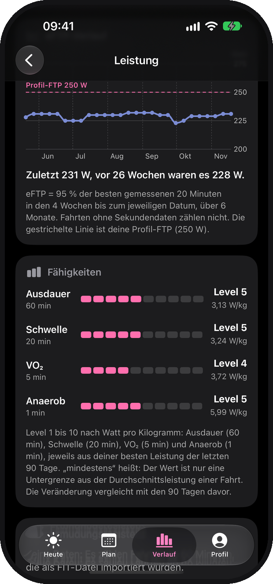 |

| Soll/Ist je Intervall | Zeit in Zonen | Verlauf 12 Wochen |
|:---:|:---:|:---:|
| 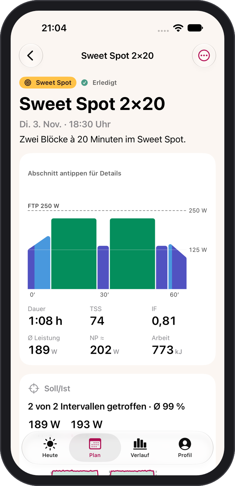 | 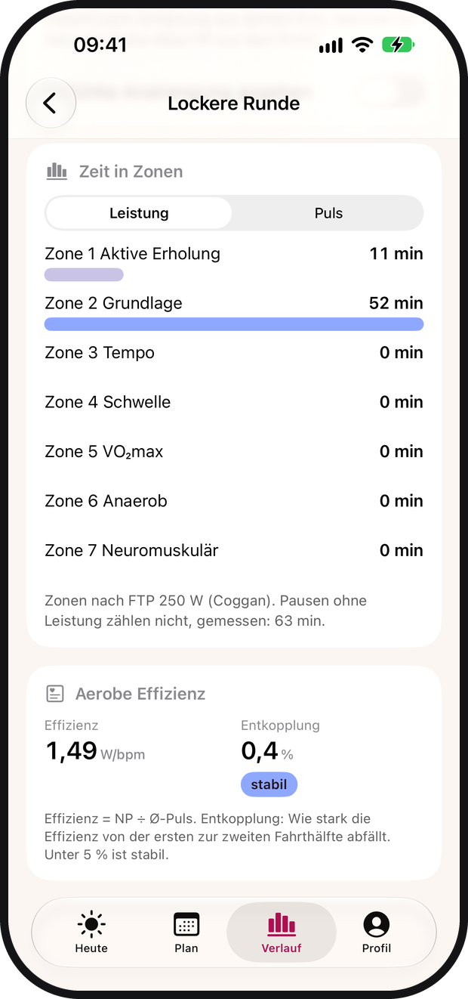 | 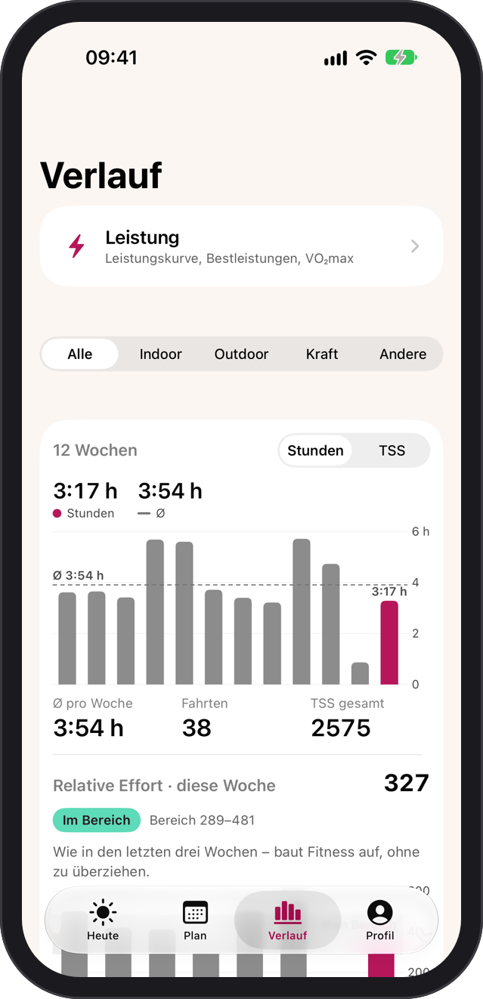 |

- **Soll/Ist je Intervall:** IndoorCoach legt den Plan auf deine Sekundendaten und zeigt je Intervall Soll- und Ist-Watt, also „2 von 2 Intervallen getroffen · Ø 98 %“, oder wo du zu leicht oder zu hart warst.
- **Zeit in Zonen** je Fahrt, nach Leistung oder Puls
- **Leistungskurve und Bestleistungen** von 5 s bis 60 min, mit Vorperiode und PR-Trophäen
- **VO₂max** aus der 5-min-Leistung (ACSM), sonst aus FTP oder Puls
- **Fitness & Freshness** (CTL, ATL, Form) und **Relative Effort** je Fahrt und Woche, mit Sekundendaten Sekunde für Sekunde aus dem Puls berechnet
- **eFTP-Verlauf**, **Trainingsverteilung** (Grundlage, Sweet Spot, Schwelle+) aus der gemessenen Zeit je Band, **Ermüdungsresistenz**
- **Aerobe Effizienz:** „Gleiche Watt, weniger Puls“ macht Grundlagenarbeit sichtbar
- **Wochenrückblick** am Sonntag mit Plan gegen Ist

## Sekundendaten vom Mac: IndoorCoach Brücke

MyWhoosh liefert über seine Schnittstelle nur Durchschnittswerte. Die FIT-Datei mit jeder Sekunde liegt aber auf dem Mac, auf dem du fährst. Die Menüleisten-App **IndoorCoach Brücke** bringt sie aufs iPhone:

1. Brücke auf dem Mac öffnen und den MyWhoosh-Ordner einmal freigeben.
2. Auf dem iPhone den Mac antippen und den 6-stelligen Code eingeben.
3. Fertig. Nach jeder Fahrt holt sich das iPhone die neuen Daten beim Öffnen der App. Fahrten, die schon aus MyWhoosh da sind, werden um die Sekundendaten ergänzt statt doppelt angelegt.

| Einrichten | Gekoppelt |
|:---:|:---:|
| 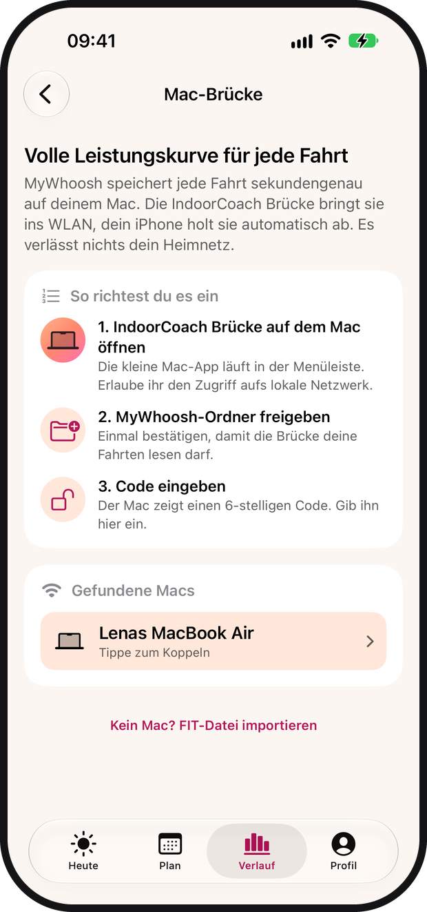 | 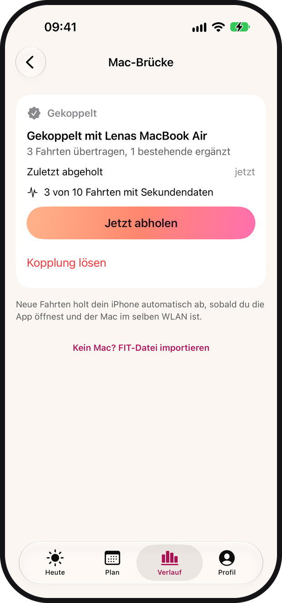 |

Die Übertragung läuft verschlüsselt (TLS mit gemeinsamem Schlüssel aus der Kopplung) und nur im eigenen WLAN, ohne Cloud. Ohne Mac geht es auch: `.fit`-Dateien von MyWhoosh, Zwift, Wahoo oder Garmin per „Öffnen in IndoorCoach“. Hintergrund und Alternativen: [Konzept](docs/14-SEKUNDENDATEN-MAC-BRUECKE.md).

## Tag und Nacht

| Heute | Heute (Dark Mode) |
|:---:|:---:|
| 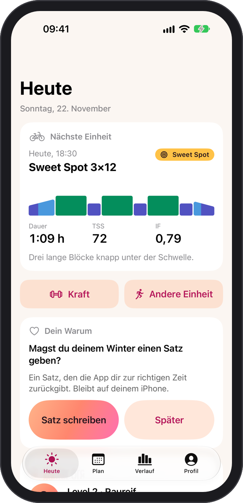 | 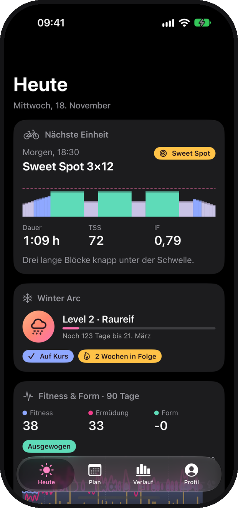 |

Farbsystem „Sunset Jelly“, geprüft auf iPhone SE und iPhone Pro, mit Dynamic Type und VoiceOver ([UX-Audit](docs/ux-audit-2026-11-20.md)).

---

## Datenquellen

| Quelle | Was kommt rein | Hinweis |
|---|---|---|
| **MyWhoosh** | Fahrten der letzten 210 Tage (Ø-Leistung, Dauer, Distanz, Puls); Upload geplanter Workouts samt Kalendereintrag in MyWhoosh | Inoffizielle Schnittstelle, kann sich ändern |
| **intervals.icu** | Fahrten samt Original-FIT (Sekundendaten); geplante Einheiten gehen als Workout in deinen intervals.icu-Kalender und von dort auf Wunsch weiter an Zwift, Garmin, Wahoo und Rouvy | Offizielle API. Anmeldung per OAuth (PKCE) folgt nach Freigabe durch intervals.icu, bis dahin persönlicher API-Key. Fahrten, die nur über Strava dort ankommen, liefert die API nicht |
| **IndoorCoach Brücke (Mac)** | Sekundendaten jeder MyWhoosh-Fahrt, automatisch: volle Leistungskurve, NP, Ermüdungsresistenz, Effizienz | Menüleisten-App liest den MyWhoosh-Ordner, das iPhone holt die Fahrten im WLAN ab ([Konzept](docs/14-SEKUNDENDATEN-MAC-BRUECKE.md)) |
| **FIT-Dateien** | Sekundendaten für die volle Leistungskurve, Ermüdungsresistenz, Effizienz | Aus der Dateien-App oder „Öffnen in IndoorCoach“, auch von Zwift, Wahoo, Garmin; ergänzt vorhandene Fahrten |
| **Strava** | Aktivitäten per OAuth | Neue Strava-API-Apps brauchen seit Juni 2026 ein Strava-Abo |
| **Bluetooth-Brustgurt** | Live-Puls und RR-Abstände für Rolle ohne Brücke, Kraft, andere Einheiten und die HRV-Morgenmessung | Jeder Gurt mit Standard-Pulsprofil; Mehrfachverbindung je nach Modell |
| **Apple Health** (optional) | Workouts anderer Sportarten, Ruhepuls, HRV, Schlaf, Gewicht; auf Wunsch Export eigener Einheiten | Lesen und Schreiben einzeln freigebbar; die Daten bleiben auf dem iPhone. MyWhoosh schreibt selbst nicht nach Health. |
| **Claude API** | Wochenpläne mit Begründung | Eigener API-Key, ca. 0,10 $ pro Plan mit Opus 5.5 |

Ohne Verbindung startet die App mit Demo-Daten, so lässt sich alles sofort ausprobieren.

## Feedback & Wünsche

In der App unter *Profil → Hilfe & Feedback → Feedback & Wünsche*: Art wählen (Fehler, Wunsch, Lob & Frage), kurz beschreiben, „Weiter zu GitHub“. Die App öffnet ein vorausgefülltes [Issue-Formular](https://github.com/jpfrehe/IndoorCoach/issues/new/choose); du tippst nur noch auf „Create“. Es gibt kein Token in der App, E-Mail-Adressen und Schlüssel werden vorher geschwärzt. Ohne GitHub-Konto lässt sich der Text kopieren.

## Loslegen

Voraussetzungen: Mac mit Xcode 27, ein iPhone mit iOS 18 oder neuer. Ein kostenloser Apple-Account reicht.

```bash
git clone https://github.com/jpfrehe/IndoorCoach.git
```

```bash
open IndoorCoach/IndoorCoach.xcodeproj
```

Dann unter *Signing & Capabilities* dein Team wählen und auf dem iPhone oder im Simulator starten. Für die Mac-Brücke das Scheme **IndoorCoachBridge** auf *My Mac* starten. Die ausführliche Anleitung mit Strava, Claude, MyWhoosh und Brücke steht in [docs/03-INSTALLATION.md](docs/03-INSTALLATION.md).

**Tests:**

```bash
cd IndoorCoach/IndoorCoachKit && swift test
```

Dazu kommen 76 UI-Walkthrough-Tests in `IndoorCoachUITests` (Simulator, inklusive automatischem Accessibility-Audit und einer Matrix für Dark Mode und große Schrift) und 7 Tests der Mac-App (Scheme `IndoorCoachBridge`). Was nur auf echten Geräten prüfbar ist, steht im [Gerätetest](docs/16-GERAETETEST.md).

**CI/CD:** GitHub Actions baut iPhone-App und Mac-Brücke und testet jeden Push ([ci.yml](.github/workflows/ci.yml)). Ein Tag `v1.2.3` startet [release.yml](.github/workflows/release.yml): Archiv, Signierung per App-Store-Connect-API-Key, Upload zu TestFlight. Einrichtung in [docs/13-APP-STORE-RELEASE.md](docs/13-APP-STORE-RELEASE.md).

## Datenschutz & Secrets

- Claude-API-Key, Strava- und intervals.icu-Tokens und die MyWhoosh-Sitzung liegen nur im iOS-Schlüsselbund, nie im Code oder in Dateien.
- intervals.icu: Anmeldung per OAuth mit PKCE. Die Client-ID in `Config/Info.plist` ist öffentlich; das Client-Secret der intervals.icu-App gehört nicht in App oder Repository (nur Passwortmanager).
- Das MyWhoosh-Passwort wird nicht gespeichert.
- Mac-Brücke: nur gekoppelte iPhones bekommen Fahrten, nur im lokalen Netz und nur verschlüsselt. Das Geheimnis wird bei der Kopplung zusätzlich mit Einmalschlüsseln geschützt, und nach 10 falschen Codes schließt das Kopplungsfenster.
- Das Diagnose-Log schwärzt Tokens, E-Mail-Adressen und den Namen deines Macs.
- Keys, Signing-Zertifikate und Provisioning-Profile gehören nicht ins Repository. Lokale Overrides liegen in `Config/Local.xcconfig` (per `.gitignore` ausgeschlossen); die eigene `DEVELOPMENT_TEAM`-ID bitte nur lokal setzen.

## Aufbau

```
App/                    App-Hülle (@main, Assets)
Bridge/                 Mac-App „IndoorCoach Brücke“ (Menüleiste): MyWhoosh-Ordner → WLAN → iPhone
Config/Info.plist       URL-Schema für Strava-OAuth, .zwo-Typ, .fit-Dokumenttyp, lokales Netzwerk
IndoorCoachKit/         Swift Package mit der gesamten Logik und UI
  Sources/IndoorCoachKit/
    Bridge/             Protokoll, TLS-PSK-Transport, Server/Client, Ordner-Scanner, Ausgang der Brücke
    Domain/             Workout, Zonen, TSS/CTL/ATL, .zwo-Export, Winter Arc, Leistungskurve, VO2max,
                        Konstanz, Challenges, Trophäen, Prognose, Fähigkeiten, Winter-Reise
    Services/           StravaClient, ClaudeClient + PlanPrompt, MyWhooshClient, FIT-Parser, Kalender,
                        Keychain, Log/Diagnose, Erinnerungen, Demo
    Store/              SwiftData-Modelle, AppModel
    UI/                 SwiftUI-Screens
  Tests/                Unit-Tests (swift test)
IndoorCoachUITests/     UI-Walkthrough- und Accessibility-Tests (Simulator)
docs/                   Konzept, Feature-Pakete, Audits, Screenshots
```

## Dokumente

1. [PRD](docs/01-PRD.md): Ziele, User Stories, Annahmen
2. [Konzept & Architektur](docs/02-KONZEPT.md): Entscheidungen, Datenmodell, Prompt-Design, MyWhoosh, Risiken
3. [Installation & Einrichtung](docs/03-INSTALLATION.md): Xcode, Strava, Claude, MyWhoosh, FIT-Import
4. [Status & nächste Schritte](docs/04-STATUS.md)
5. [Winter Arc: Relative Effort, Fitness & Freshness, Level](docs/05-FEATURES-WINTER-ARC.md)
6. [Backlog bis zur Pilotphase](docs/06-BACKLOG-PILOT.md)
7. [Pilot-Testplan](docs/07-PILOT-TESTPLAN.md)
8. [Leistung: Leistungskurve, Bestleistungen, VO₂max](docs/08-FEATURES-LEISTUNG.md)
9. [Brainstorming & Marktanalyse: Winter-Motivation](docs/09-BRAINSTORM-WINTER-MOTIVATION.md)
10. [Konstanz-Paket: Serie mit Joker, Wochenrückblick, Challenges, Effizienz](docs/10-KONSTANZ-PAKET.md)
11. [Winter-Paket 2: Prognose, Fähigkeiten, Vorjahr, Winter-Reise](docs/11-WINTER-PAKET-2.md)
12. [UX-Audit 1](docs/ux-audit-2026-11-17.md), [UX-Audit 2](docs/ux-audit-2026-11-17-b.md) und [UX-Audit 3](docs/ux-audit-2026-11-20.md)
13. [Paket „Öffnung“: Onboarding mit Verbindungen, Feature-Tour, Feedback, CI/CD](docs/12-PAKET-OEFFNUNG.md)
20. [Konzept: Einführung mit passenden Diensten (Personas, Journey)](docs/20-KONZEPT-ONBOARDING-DIENSTE.md)
21. [Konzept: Diagramm-Designsystem und Workout-Profil](docs/21-KONZEPT-DIAGRAMME.md)
22. [Marktanalyse: Begeisterungsmerkmale je Persona, „Vom Frost zum Frühling“](docs/22-MARKTANALYSE-BEGEISTERUNG.md)
14. [App-Store-Release mit GitHub Actions](docs/13-APP-STORE-RELEASE.md) und [Datenschutzerklärung (Entwurf)](docs/PRIVACY.md)
15. [Sekundendaten aus MyWhoosh: Alternativen, User Journey, Mac-Brücke](docs/14-SEKUNDENDATEN-MAC-BRUECKE.md)
16. [Sekundendaten-Auswertung: Zeit in Zonen, Soll/Ist je Intervall, Einheit anpassen](docs/15-PAKET-SEKUNDENDATEN-AUSWERTUNG.md)
17. [Gerätetest iPhone + Mac](docs/16-GERAETETEST.md)
18. [Brainstorming & Roadmap: Daten über das Workout hinaus (Brustgurt, Krafttraining, Apple Health, Check-in, Aufwärm-Check)](docs/17-BRAINSTORM-DATENQUELLEN-ALLTAG.md)

## Roadmap

- Gerätetests mit echten Gurten (Hintergrundbetrieb, Mehrfachverbindung) und Kalibrierung des Trend-Wächters im Pilot
- Wellness aus intervals.icu oder Garmin, persönliche Muster (Saison 2)
- Widget „Heute“ mit Level und nächster Einheit
- Mac-Brücke auch unterwegs über iCloud, Mac-App über den App Store
- Accountability-Gruppe für 3–5 Fahrer, Rangliste nach Plan-Treue statt Watt (braucht ein Backend)

Ideen und Fehler gerne als [Issue](https://github.com/jpfrehe/IndoorCoach/issues).

---

<sub>IndoorCoach ist ein privates Projekt und steht in keiner Verbindung zu Strava, MyWhoosh, Zwift, Wahoo oder TrainerRoad. Alle Markennamen gehören ihren Inhabern. Die Screenshots zeigen Demo-Daten im iOS-Simulator.</sub>
