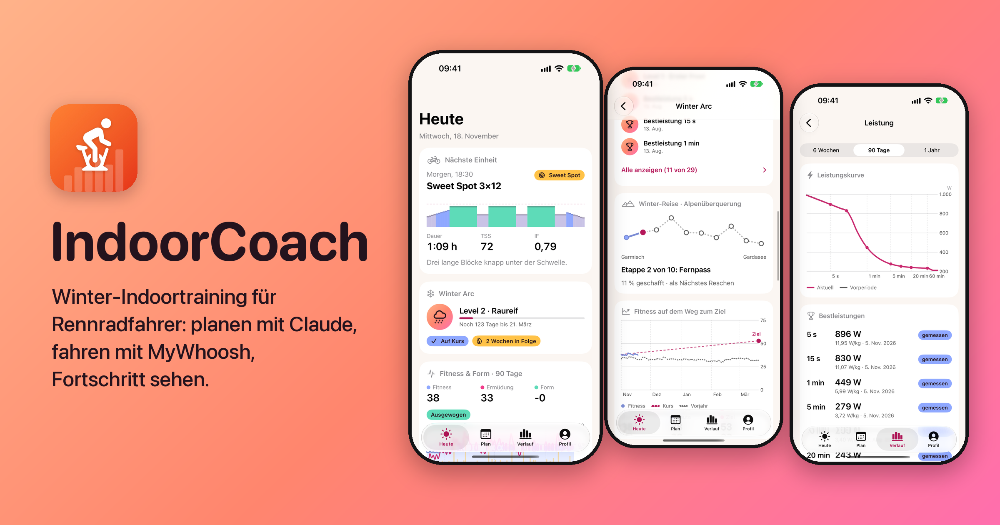
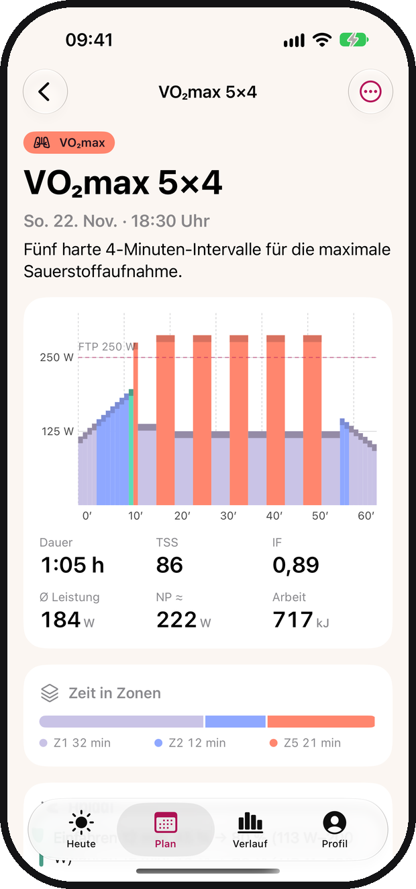
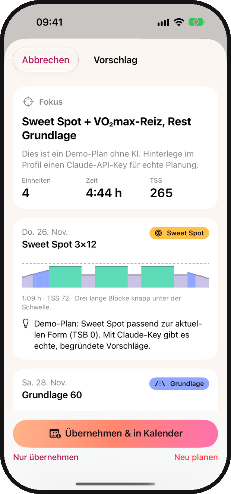
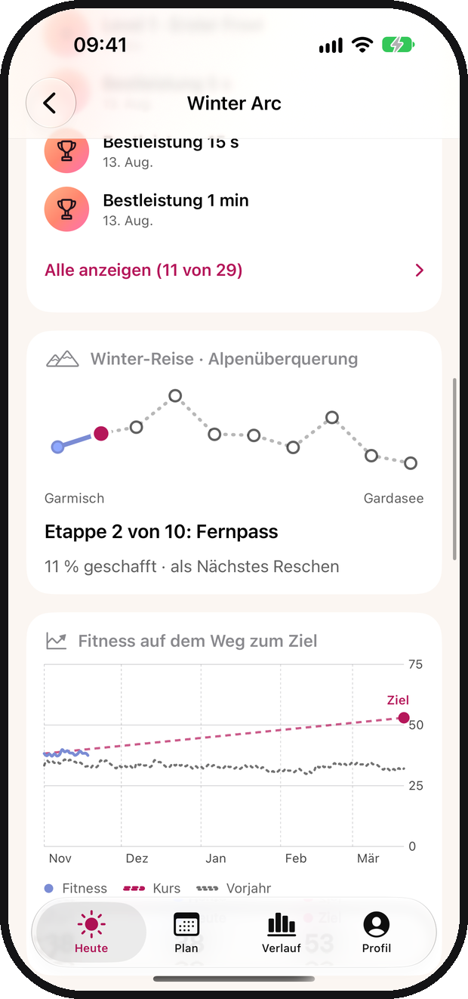
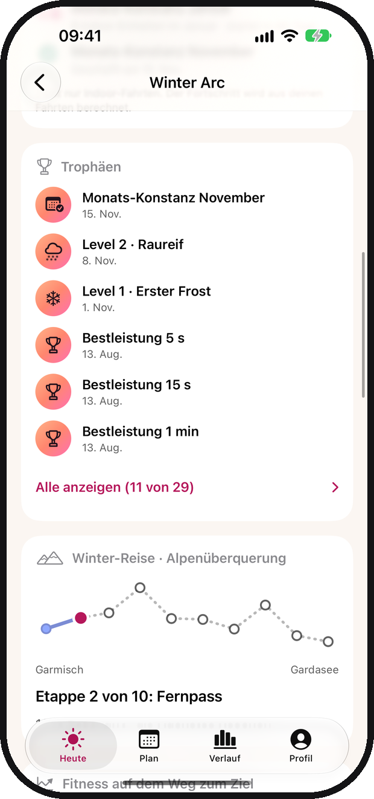
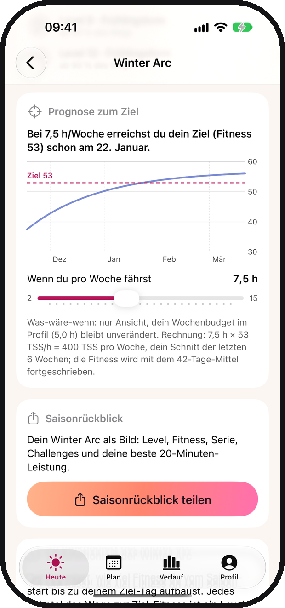

<p align="center">
  
</p>

<p align="center">
  
  
  
  
  
  
  <a href="https://github.com/jpfrehe/IndoorCoach/actions/workflows/ci.yml"></a>
</p>

# IndoorCoach

**Der persönliche Winter-Coach für Rennradfahrer auf der Rolle.**
IndoorCoach plant deine Indoor-Woche mit Claude, schickt die Einheiten direkt an MyWhoosh und in deinen Kalender – und zeigt dir ehrlich, ob du auf Kurs bist, um im Frühling in Form zu sein.

Im Winter sinkt das Radvolumen bei vielen um ein Drittel. IndoorCoach setzt genau da an:
- **Konstanz statt Tagesstreaks:** Wochen-Serie mit Joker, Ruhewochen zählen als Erfolg.
- **Fortschritt sichtbar machen:** Leistungskurve, VO₂max, Fähigkeitslevel und Fitness-Prognose zeigen, dass die Arbeit ankommt.
- **Ein Grund für die nächste Einheit:** Winter Arc mit 10 Leveln, Alpenüberquerung als Etappenreise, Challenges und Trophäen.

Alles läuft auf dem iPhone. Es gibt kein Backend und kein Konto bei IndoorCoach; Schlüssel und Sitzungen liegen im iOS-Schlüsselbund.

**In zwei Minuten startklar:** Das Onboarding fragt Training und Trainingstage ab, verbindet MyWhoosh und prüft deinen Claude-API-Key direkt beim Einrichten. Danach zeigt eine kurze animierte Tour, was die App kann. Alles ist überspringbar – ohne Verbindung startet die App mit Demo-Daten.

---

## Planen mit Claude

Claude kennt deine Form (CTL/ATL/TSB), dein Ziel, deine Trainingstage und dein Wochenbudget. Er schlägt strukturierte Einheiten mit Begründung vor; du übernimmst sie mit einem Tipp in Kalender und MyWhoosh. Als Rückfallweg gibt es den Export als `.zwo` für Zwift und andere Apps.

| Wochenplan | Einheit im Detail | Vorschlag des Coachs |
|:---:|:---:|:---:|
|  |  |  |

## Winter Arc: Motivation, die das Richtige belohnt

Vom 1. November bis zum Frühlingsziel wächst deine Fitness Level für Level – „Erster Frost“ bis „Frühlingsform“. Die Fitness-Kurve zeigt Kurs und Vorjahr, die Winter-Reise führt von Garmisch an den Gardasee.

| Winter Arc & Konstanz | Winter-Reise & Vorjahr | Trophäen |
|:---:|:---:|:---:|
|  |  |  |

| Prognose mit Was-wäre-wenn | Saisonrückblick zum Teilen |
|:---:|:---:|
|  |  |

**Leitplanken:** keine Tagesstreaks, keine Ranglisten nach Watt, Ruhetage zählen. Jede Kennzahl sagt, woher sie kommt: gemessen, Mindestwert oder geschätzt.

## Analyse wie im Premium-Abo – nur ohne Abo

| Leistungskurve & Bestleistungen | VO₂max & aerobe Effizienz | Fähigkeitslevel (Dark Mode) |
|:---:|:---:|:---:|
|  |  |  |

- **Leistungskurve und Bestleistungen** von 5 s bis 60 min, mit Vorperiode und PR-Trophäen
- **VO₂max** aus der 5-min-Leistung (ACSM), sonst aus FTP oder Puls
- **Fitness & Freshness** (CTL, ATL, Form) und **Relative Effort** je Fahrt und Woche
- **eFTP-Verlauf**, **Trainingsverteilung** (Grundlage, Sweet Spot, Schwelle+), **Ermüdungsresistenz**
- **Aerobe Effizienz:** „Gleiche Watt, weniger Puls“ macht Grundlagenarbeit sichtbar
- **Wochenrückblick** am Sonntag mit Plan gegen Ist

## Tag und Nacht

| Heute | Heute (Dark Mode) |
|:---:|:---:|
|  |  |

Farbsystem „Sunset Jelly“, geprüft auf iPhone SE und iPhone Pro, mit Dynamic Type und VoiceOver ([UX-Audit](docs/ux-audit-2026-11-17-b.md)).

---

## Datenquellen

| Quelle | Was kommt rein | Hinweis |
|---|---|---|
| **MyWhoosh** | Fahrten der letzten 210 Tage (Ø-Leistung, Dauer, Distanz, Puls); Upload geplanter Workouts samt Kalendereintrag in MyWhoosh | Inoffizielle Schnittstelle, kann sich ändern |
| **IndoorCoach Brücke (Mac)** | Sekundendaten jeder MyWhoosh-Fahrt, automatisch: volle Leistungskurve, NP, Ermüdungsresistenz, Effizienz | Menüleisten-App liest den MyWhoosh-Ordner, das iPhone holt die Fahrten im WLAN ab ([Konzept](docs/14-SEKUNDENDATEN-MAC-BRUECKE.md)) |
| **FIT-Dateien** | Sekundendaten für die volle Leistungskurve, Ermüdungsresistenz, Effizienz | Aus der Dateien-App oder „Öffnen in IndoorCoach“, auch von Zwift, Wahoo, Garmin; ergänzt vorhandene Fahrten |
| **Strava** | Aktivitäten per OAuth | Neue Strava-API-Apps brauchen seit Juni 2026 ein Strava-Abo |
| **Claude API** | Wochenpläne mit Begründung | Eigener API-Key, ca. 0,10 $ pro Plan mit Opus 5.5 |

Ohne Verbindung startet die App mit Demo-Daten, so lässt sich alles sofort ausprobieren.

## Feedback & Wünsche

In der App unter *Profil → Hilfe & Feedback → Feedback & Wünsche*: Art wählen (Fehler, Wunsch, Lob & Frage), kurz beschreiben, „Weiter zu GitHub“. Die App öffnet ein vorausgefülltes [Issue-Formular](https://github.com/jpfrehe/IndoorCoach/issues/new/choose); du tippst nur noch auf „Create“. Es gibt kein Token in der App, E-Mail-Adressen und Schlüssel werden vorher geschwärzt. Ohne GitHub-Konto lässt sich der Text kopieren.

## Loslegen

Voraussetzungen: Mac mit Xcode 27, ein iPhone mit iOS 18 oder neuer. Ein kostenloser Apple-Account reicht.

```bash
git clone https://github.com/jpfrehe/IndoorCoach.git
```

```bash
open IndoorCoach/IndoorCoach.xcodeproj
```

Dann unter *Signing & Capabilities* dein Team wählen und auf dem iPhone oder im Simulator starten. Die ausführliche Anleitung mit Strava, Claude und MyWhoosh steht in [docs/03-INSTALLATION.md](docs/03-INSTALLATION.md).

**Tests:**

```bash
cd IndoorCoach/IndoorCoachKit && swift test
```

Dazu kommen 39 UI-Walkthrough-Tests in `IndoorCoachUITests` (Simulator, inklusive automatischem Accessibility-Audit und einer Matrix für Dark Mode und große Schrift).

**CI/CD:** GitHub Actions baut und testet jeden Push ([ci.yml](.github/workflows/ci.yml)). Ein Tag `v1.2.3` startet [release.yml](.github/workflows/release.yml): Archiv, Signierung per App-Store-Connect-API-Key, Upload zu TestFlight. Einrichtung in [docs/13-APP-STORE-RELEASE.md](docs/13-APP-STORE-RELEASE.md).

## Datenschutz & Secrets

- Claude-API-Key, Strava-Tokens und die MyWhoosh-Sitzung liegen nur im iOS-Schlüsselbund, nie im Code oder in Dateien.
- Das MyWhoosh-Passwort wird nicht gespeichert.
- Das Diagnose-Log schwärzt Tokens und E-Mail-Adressen.
- Keys, Signing-Zertifikate und Provisioning-Profile gehören nicht ins Repository. Lokale Overrides liegen in `Config/Local.xcconfig` (per `.gitignore` ausgeschlossen); die eigene `DEVELOPMENT_TEAM`-ID bitte nur lokal setzen.

## Aufbau

```
App/                    App-Hülle (@main, Assets)
Bridge/                 Mac-App „IndoorCoach Brücke“ (Menüleiste): MyWhoosh-Ordner → WLAN → iPhone
Config/Info.plist       URL-Schema für Strava-OAuth, .zwo-Typ, .fit-Dokumenttyp, lokales Netzwerk
IndoorCoachKit/         Swift Package mit der gesamten Logik und UI
  Sources/IndoorCoachKit/
    Bridge/             Protokoll, TLS-PSK-Transport, Server/Client, Ordner-Scanner, Ausgang der Brücke
    Domain/             Workout, Zonen, TSS/CTL/ATL, .zwo-Export, Winter Arc, Leistungskurve, VO2max,
                        Konstanz, Challenges, Trophäen, Prognose, Fähigkeiten, Winter-Reise
    Services/           StravaClient, ClaudeClient + PlanPrompt, MyWhooshClient, FIT-Parser, Kalender,
                        Keychain, Log/Diagnose, Erinnerungen, Demo
    Store/              SwiftData-Modelle, AppModel
    UI/                 SwiftUI-Screens
  Tests/                Unit-Tests (swift test)
IndoorCoachUITests/     UI-Walkthrough- und Accessibility-Tests (Simulator)
docs/                   Konzept, Feature-Pakete, Audits, Screenshots
```

## Dokumente

1. [PRD](docs/01-PRD.md): Ziele, User Stories, Annahmen
2. [Konzept & Architektur](docs/02-KONZEPT.md): Entscheidungen, Datenmodell, Prompt-Design, MyWhoosh, Risiken
3. [Installation & Einrichtung](docs/03-INSTALLATION.md): Xcode, Strava, Claude, MyWhoosh, FIT-Import
4. [Status & nächste Schritte](docs/04-STATUS.md)
5. [Winter Arc: Relative Effort, Fitness & Freshness, Level](docs/05-FEATURES-WINTER-ARC.md)
6. [Backlog bis zur Pilotphase](docs/06-BACKLOG-PILOT.md)
7. [Pilot-Testplan](docs/07-PILOT-TESTPLAN.md)
8. [Leistung: Leistungskurve, Bestleistungen, VO₂max](docs/08-FEATURES-LEISTUNG.md)
9. [Brainstorming & Marktanalyse: Winter-Motivation](docs/09-BRAINSTORM-WINTER-MOTIVATION.md)
10. [Konstanz-Paket: Serie mit Joker, Wochenrückblick, Challenges, Effizienz](docs/10-KONSTANZ-PAKET.md)
11. [Winter-Paket 2: Prognose, Fähigkeiten, Vorjahr, Winter-Reise](docs/11-WINTER-PAKET-2.md)
12. [UX-Audit 1](docs/ux-audit-2026-11-17.md) und [UX-Audit 2](docs/ux-audit-2026-11-17-b.md)
13. [Paket „Öffnung“: Onboarding mit Verbindungen, Feature-Tour, Feedback, CI/CD](docs/12-PAKET-OEFFNUNG.md)
14. [App-Store-Release mit GitHub Actions](docs/13-APP-STORE-RELEASE.md) und [Datenschutzerklärung (Entwurf)](docs/PRIVACY.md)
15. [Sekundendaten aus MyWhoosh: Alternativen, User Journey, Mac-Brücke](docs/14-SEKUNDENDATEN-MAC-BRUECKE.md)

## Roadmap

- Widget „Heute“ mit Level und nächster Einheit
- Accountability-Gruppe für 3–5 Fahrer, Rangliste nach Plan-Treue statt Watt (braucht ein Backend)

Ideen und Fehler gerne als [Issue](https://github.com/jpfrehe/IndoorCoach/issues).

---

<sub>IndoorCoach ist ein privates Projekt und steht in keiner Verbindung zu Strava, MyWhoosh, Zwift, Wahoo oder TrainerRoad. Alle Markennamen gehören ihren Inhabern. Die Screenshots zeigen Demo-Daten im iOS-Simulator.</sub>
